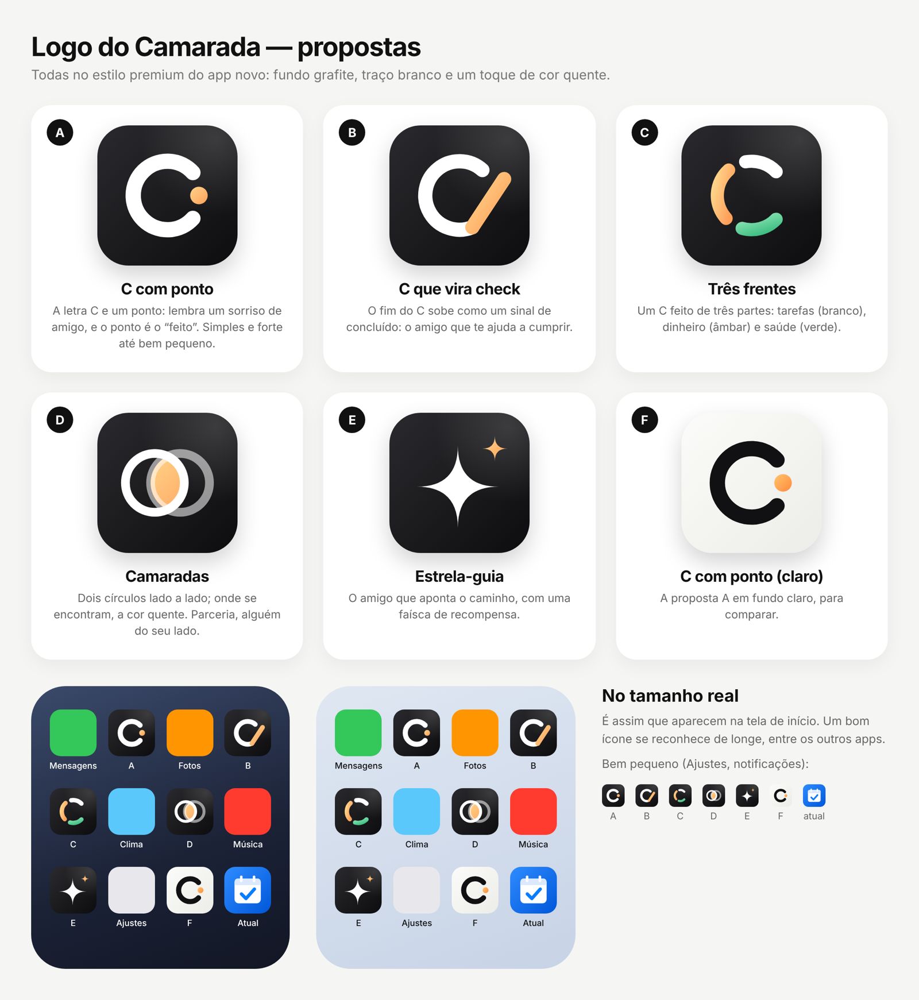

# Propostas de logo

| | Nome | Ideia |
|---|---|---|
| A | C com ponto | A letra C e um ponto: lembra um sorriso de amigo, e o ponto é o "feito". |
| B | C que vira check | O fim do C sobe como um sinal de concluído. |
| C | Três frentes | Um C de três partes: tarefas (branco), dinheiro (âmbar) e saúde (verde). |
| D | Camaradas | Dois círculos lado a lado; onde se encontram, a cor quente. |
| E | Estrela-guia | O amigo que aponta o caminho, com uma faísca de recompensa. |
| F | C com ponto (claro) | A proposta A em fundo claro. |

